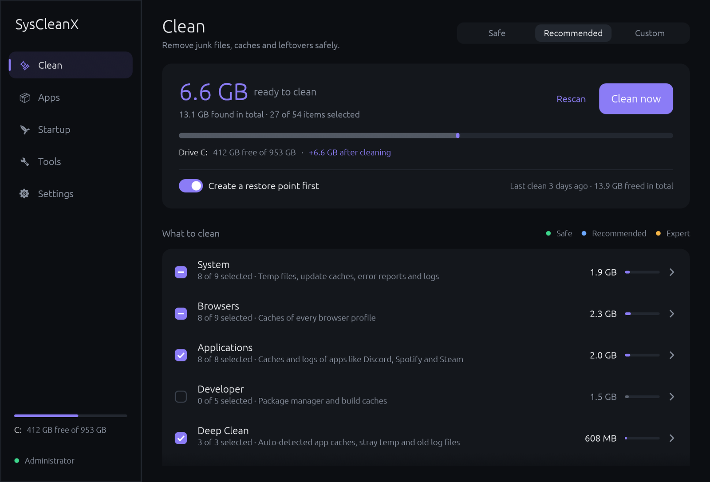
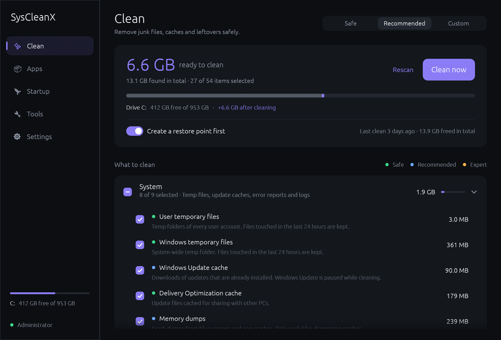
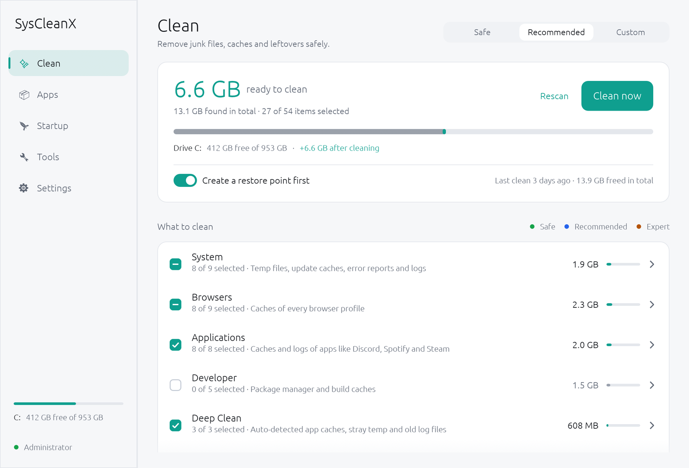
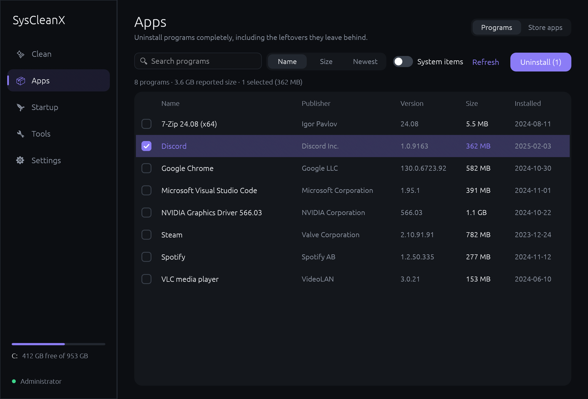
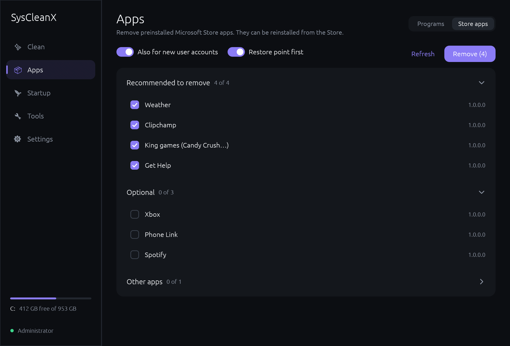
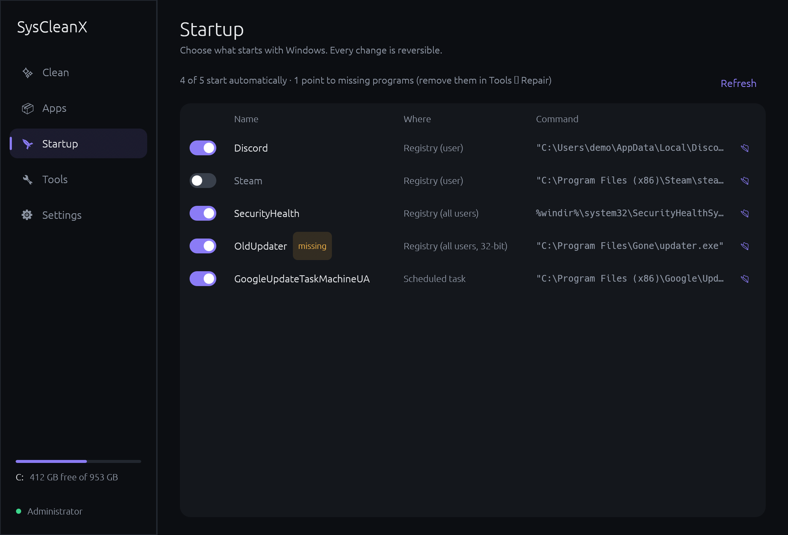
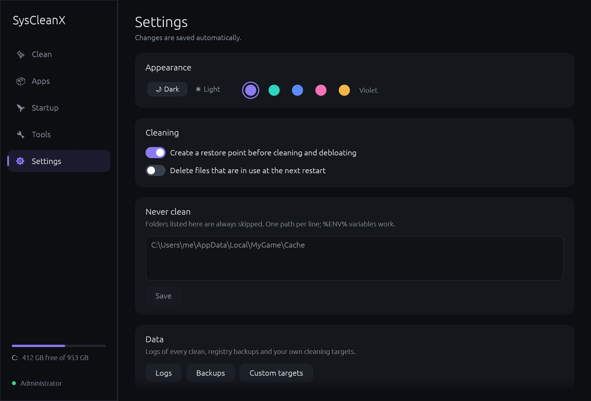

<div align="center">


# SysCleanX

**A fast, lightweight and safety-first PC cleaner for Windows 10 & 11.**

[](https://github.com/htmnsrc/SysCleanX/releases/latest)


[](LICENSE)



</div>

SysCleanX finds and removes junk files, uninstalls programs together with the leftovers they leave
behind, controls what starts with Windows, removes preinstalled bloat and repairs broken leftovers. It is
a single ~6 MB native app: no runtime to install, no background service, no telemetry, and it starts
instantly.

Everything is designed around one rule: **clean thoroughly, but never break Windows or touch your files.**

## Contents

- [Highlights](#highlights)
- [Download and install](#download-and-install)
- [Screenshots](#screenshots)
- [Using SysCleanX](#using-syscleanx)
  - [Clean](#clean) · [Apps](#apps) · [Startup](#startup) · [Tools](#tools) · [Settings](#settings)
- [Everything SysCleanX can clean](#everything-syscleanx-can-clean)
- [How SysCleanX keeps your PC safe](#how-syscleanx-keeps-your-pc-safe)
- [Where SysCleanX stores its data](#where-syscleanx-stores-its-data)
- [Custom cleaning targets](#custom-cleaning-targets)
- [Building from source](#building-from-source)
- [Project structure](#project-structure)
- [FAQ](#faq)
- [What's new in 2.0](#whats-new-in-20)
- [Contributing](#contributing) · [License](#license)

## Highlights

- **81 cleaning targets** across Windows, every browser profile, popular apps, developer tools and
  auto-detected app caches, from everyday junk to expert cleanups like `Windows.old`.
- **Safety first**: a hard-coded guard protects system and personal folders, links are never followed,
  recent files are kept, app databases are skipped and expert actions can create a restore point first.
- **Complete uninstaller** for 64-bit, 32-bit and per-user programs, with a leftover scan afterwards.
- **Startup manager** that works exactly like Task Manager's (every change is reversible).
- **Debloat** preinstalled Microsoft Store apps from a curated, protected list.
- **Repair** broken shortcuts, dead startup entries and orphaned leftovers of removed programs.
- **Disk usage** explorer and a content-based **duplicate finder**.
- **Fast**: written in Rust; scans run in parallel and every page stays responsive.
- Dark and light themes with five accent colours.

## Download and install

### Installer (recommended)

1. Download **`SysCleanX-Setup-<version>.exe`** from the
   [latest release](https://github.com/htmnsrc/SysCleanX/releases/latest).
2. Run it and follow the setup wizard.

The installer:

- installs SysCleanX into `C:\Program Files\SysCleanX`
- adds a Start menu shortcut and, optionally, a desktop shortcut
- registers SysCleanX in **Settings → Apps** and **Control Panel → Programs** (icon, version, publisher,
  size, uninstall)
- lets you start SysCleanX from the Run dialog (**Win + R → `SysCleanX`**)
- upgrades in place: running a newer setup installs over the old version in the same folder

To uninstall, use **Settings → Apps → SysCleanX → Uninstall**. The uninstaller removes the app,
its shortcuts and registry entries, then asks whether to also delete your settings, logs and backups
(kept by default).

Silent install and uninstall for scripted deployments:

```bat
SysCleanX-Setup-2.0.0.exe /S
"C:\Program Files\SysCleanX\Uninstall.exe" /S
```

### Portable

Prefer not to install? Download **`SysCleanX.exe`** from the same release and run it from anywhere.
Settings are stored in your user profile either way.

### Requirements

- Windows 10 or 11, 64-bit
- Administrator rights for system-wide cleaning (SysCleanX asks when it starts; if you decline, it runs
  in a limited mode where system items are marked *needs admin*)
- A graphics driver with OpenGL 2.0 or newer (any normal PC; very bare virtual machines may lack it)

> **"Windows protected your PC"**: the installer is not code-signed yet, so Microsoft SmartScreen warns
> the first time you run it. Click **More info → Run anyway**.

## Screenshots

| | |
|:---:|:---:|
| <br/>**Clean**: every item shows its safety level, what it removes and its size | <br/>**Light theme** with the teal accent |
| <br/>**Apps → Programs**: complete uninstaller | <br/>**Apps → Store apps**: remove preinstalled bloat |
| <br/>**Startup**: reversible, Task Manager compatible | <br/>**Settings**: theme, accent, exclusions |

## Using SysCleanX

The sidebar has five sections. Related tools share a page and are switched with the tabs at the top
right. The bottom of the sidebar shows how much space is free on your system drive.

### Clean

SysCleanX scans as soon as it opens. Nothing is ever deleted until you press **Clean now** and confirm.

**The summary card** shows:

- how much is **ready to clean** (the items you have selected) and how much was found in total
- a bar of your system drive: used space, the junk part of it (highlighted) and the space you gain
- when you last cleaned and how much SysCleanX has freed in total
- **Create a restore point first**: when on, SysCleanX creates a System Restore point before cleaning
  (needs System Protection turned on for your system drive; if that fails you can cancel or clean
  without it)

**Presets** at the top right select items for you:

| Preset | Selects |
|---|---|
| **Safe** | Only items marked Safe: caches and temp files that apps rebuild by themselves |
| **Recommended** | Safe items plus Recommended ones (the default) |
| **Custom** | Shown when you pick items yourself; clicking it opens every category |

**Categories** (System, Browsers, Applications, Developer, Deep Clean, Privacy, Advanced) start collapsed.
Each shows how many of its items are selected, what it covers, its size and a bar with its share of all
junk found. Click a category to expand it; tick its box to select everything in it (except Expert items
and apps that are open).

**Each item** shows a coloured dot for its safety level, a short description and its size. Hover an item
to see how many files it holds and the folders involved.

| Dot | Level | Meaning |
|:---:|---|---|
| 🟢 | **Safe** | Pure caches and temp files. Apps and Windows rebuild them automatically. |
| 🔵 | **Recommended** | Safe to remove, with a small trade-off (for example logs or crash dumps you might want when troubleshooting). |
| 🟠 | **Expert** | Powerful cleanups with real trade-offs (for example `Windows.old` removes the ability to roll back a Windows upgrade). Never selected automatically and always confirmed separately. |

Other labels you may see:

- **In use**: the app that owns this cache is running (for example Chrome). It is unticked so the app is
  not disturbed. Close the app, or tick the item to clean anyway; files the app is using are skipped.
- **Admin**: needs administrator rights (restart SysCleanX as administrator from the sidebar).
- **tick to measure**: a few expert items (old drivers, orphaned installer packages, old restore points)
  are slow to measure, so they are only measured once you select them.
- **Show N items with nothing to clean** at the bottom reveals items that are currently empty.

After cleaning, a notification shows how much was freed and **Details** lists the result of every item,
with a link to the full log of every deleted file.

### Apps

#### Programs (uninstaller)

Lists every installed program: 64-bit, 32-bit and per-user installations. Search by name or
publisher, sort by name, size or newest, and switch **System items** on to also see system components and
updates.

Select one or more programs and press **Uninstall**. SysCleanX then:

1. runs each program's own uninstaller in turn (optionally **silently** when the program supports it),
   waiting until it has really finished, including uninstallers that relaunch themselves from a temp
   folder
2. checks whether the program is actually gone
3. scans for **leftovers**: the install folder, folders in Program Files, ProgramData, AppData and the
   Start menu, and registry keys under `Software`, matched by program and publisher name. Anything that
   could belong to another installed program is never suggested
4. shows the results so you can review and remove the leftovers: folders go to the **Recycle Bin**,
   registry keys are **exported to a `.reg` backup** before they are deleted

#### Store apps (debloat)

Removes preinstalled Microsoft Store apps. Apps are grouped as:

- **Recommended to remove** (preselected): Bing News/Weather/Finance/Sports, Tips, Get Help, Solitaire,
  Microsoft 365 hub, Feedback Hub, Movies & TV, Mixed Reality Portal, Paint 3D, Clipchamp, Cortana,
  Maps, Candy Crush and other preinstalled games, social media and streaming apps, and more.
- **Optional**: apps some people use, such as the Xbox apps, Phone Link, Teams, the new Outlook, Clock,
  Camera, Sound Recorder, Media Player, Sticky Notes and To Do.
- **Other apps**: everything else that can be removed.

Core parts of Windows can never be removed (they show a lock): Microsoft Store, App Installer (winget),
Windows Security, Photos, Notepad, Terminal, Paint, Snipping Tool, Calculator, media codecs and runtimes.
**Also for new user accounts** prevents removed apps from being installed for future accounts.
Removed apps can be reinstalled from the Microsoft Store at any time.

### Startup

Shows everything that starts automatically:

- **Registry Run entries** for your account and for all users (64-bit and 32-bit)
- **Startup folders** for your account and for all users
- **Scheduled tasks** that run at sign-in or boot (Microsoft's own tasks are left out)

Flip the switch to turn an entry off or on. This uses the same mechanism as Task Manager's Startup tab,
so changes are fully reversible and show up there too. Entries pointing to a program that no longer exists
are marked **missing**. 📂 opens the program's location in Explorer.

### Tools

#### Repair

**Scan** looks for broken leftovers of removed programs:

| Finding | Fix |
|---|---|
| Broken shortcuts (Start menu, desktop, Quick Launch) pointing to missing programs | Moved to the Recycle Bin |
| Startup entries pointing to missing programs | Deleted, registry backed up first |
| Uninstall entries whose uninstaller and install folder are gone | Deleted, registry backed up first |
| Scheduled tasks pointing to missing programs | Deleted, task exported to XML first |
| Services pointing to missing programs (unticked by default) | Deleted, registry backed up first |
| App data folders that no installed program uses and that have not changed for 90 days (unticked, review carefully) | Moved to the Recycle Bin |

System components, Microsoft runtimes and installer bundles are never reported as orphaned.

The **Hibernation file** switch turns hibernation off (freeing `hiberfil.sys`, often several GB) or back
on. Turning it off also disables Fast Startup.

#### Disk usage

Pick a drive (or type a folder) and press **Analyze**. You get a folder tree sorted by size with bars you
can click to drill down, plus the **100 largest files** with their age, a button to show each in Explorer
and one to move it to the Recycle Bin.

#### Duplicates

Finds identical files by **content**, not by name: files are grouped by size, then compared by a hash of
their first and last 16 KB, then confirmed with a full xxHash3 128-bit hash. Searches your Desktop,
Documents, Downloads, Pictures, Videos and Music by default (any folders can be added) and skips files
smaller than 1 MB by default.

**Keep newest** or **Keep oldest** selects every other copy. SysCleanX never removes every copy of a
file: groups where all copies are selected are skipped. Selected files go to the Recycle Bin.

### Settings

| Setting | What it does |
|---|---|
| Appearance | Dark or light theme, and the accent colour (violet, teal, blue, rose, amber) |
| Create a restore point before cleaning and debloating | Same switch as on the Clean page |
| Delete files that are in use at the next restart | Files locked by Windows or apps are scheduled for deletion when Windows next starts instead of being skipped |
| Never clean | Folders (or files) that are always skipped. One per line; `%ENV%` variables such as `%LOCALAPPDATA%` work |
| Data | Open the logs, the registry backups, or your custom cleaning targets |
| About | Version, number of cleaning targets, last clean and total space freed |

All settings are saved automatically.

## Everything SysCleanX can clean

**81 targets in total.** *(admin)* means the item needs administrator rights.
"On by default" is the **Recommended** preset. Folders are always emptied, never deleted themselves.

#### System

| Item | Level | On by default | What it removes |
|---|---|:---:|---|
| User temporary files | Safe | ✓ | Temp folders of every user account. Files touched in the last 24 hours are kept. |
| Windows temporary files *(admin)* | Safe | ✓ | System-wide temp folder. Files touched in the last 24 hours are kept. |
| Recycle Bin | Safe | ✓ | Empties the Recycle Bin on all drives. |
| Windows Update cache *(admin)* | Recommended | ✓ | Downloads of updates that are already installed. Windows Update is paused while cleaning. |
| Delivery Optimization cache *(admin)* | Safe | ✓ | Update files cached for sharing with other PCs. |
| Windows error reports | Safe | ✓ | Queued and archived Windows Error Reporting files. |
| Memory dumps | Recommended | ✓ | Crash dumps from blue screens and app crashes. Only useful for diagnosing crashes. |
| Windows log files *(admin)* | Recommended | ✓ | Setup, servicing and update logs older than 7 days. |
| Thumbnail & icon cache | Recommended | ✓ | Explorer rebuilds it automatically. Files Explorer is using are skipped. |
| DirectX & GPU shader caches | Recommended |  | Rebuilt automatically. Games may stutter briefly the first time they start afterwards. |
| GPU driver installer leftovers | Recommended | ✓ | Extracted NVIDIA/AMD driver setup files and downloaded driver packages. |
| Store app temporary files | Recommended | ✓ | Temp and web cache folders of Microsoft Store apps. |
| Windows upgrade leftovers *(admin)* | Recommended | ✓ | Temporary setup files, upgrade logs and install media left by feature updates (via Windows Disk Cleanup). |

#### Browsers

| Item | Level | On by default | What it removes |
|---|---|:---:|---|
| Chromium browsers | Safe | ✓ | Cache, code cache, GPU/shader caches and crash reports of **every profile** of Google Chrome, Microsoft Edge, Brave, Vivaldi, Opera, Opera GX, Chromium, Yandex Browser, Arc, Thorium. |
| Mozilla Firefox | Safe | ✓ | Cache, startup cache, thumbnails and crash reports for every profile. |
| LibreWolf | Safe | ✓ | Cache and temporary files. |
| Waterfox | Safe | ✓ | Cache and temporary files. |
| Internet Explorer & legacy web cache | Safe | ✓ | WinINet cache used by Internet Explorer mode and older apps. |

#### Applications

| Item | Level | On by default | What it removes |
|---|---|:---:|---|
| Discord | Safe | ✓ | Cache and temporary files. |
| Spotify | Recommended | ✓ | Streaming cache. Spotify rebuilds it as you listen. |
| Microsoft Teams | Safe | ✓ | Cache and temporary files. |
| Slack | Safe | ✓ | Cache and temporary files. |
| Visual Studio Code | Safe | ✓ | Caches, old compiled data, downloaded extension packages and logs. |
| Zoom | Safe | ✓ | Cache and temporary files. |
| Steam | Safe | ✓ | Web cache, logs and crash dumps. Games and settings are not touched. |
| Epic Games Launcher | Safe | ✓ | Cache and temporary files. |
| Battle.net | Safe | ✓ | Cache and temporary files. |
| Java cache | Safe | ✓ | Cache and temporary files. |
| Adobe media cache | Recommended | ✓ | Premiere Pro / After Effects media cache. Rebuilt when projects are opened. |
| OneDrive logs | Safe | ✓ | Cache and temporary files. |

#### Developer

| Item | Level | On by default | What it removes |
|---|---|:---:|---|
| pip cache | Recommended |  | Cache and temporary files. |
| npm cache | Recommended |  | Cache and temporary files. |
| Yarn cache | Recommended |  | Cache and temporary files. |
| NuGet HTTP cache | Recommended |  | Cache and temporary files. |
| Gradle caches | Recommended |  | Downloaded dependencies and build caches. The next build downloads them again. |
| Go build cache | Recommended |  | Cache and temporary files. |
| Cargo registry cache | Recommended |  | Downloaded crate archives (extracted sources are kept). |

#### Deep Clean

| Item | Level | On by default | What it removes |
|---|---|:---:|---|
| Other app caches (auto-detected) | Recommended | ✓ | Chromium, Electron and WebView2 caches of any other app under AppData. |
| App crash reports | Safe | ✓ | Cache and temporary files. |
| Stray temporary files | Recommended | ✓ | *.tmp files older than 7 days left behind anywhere in AppData. App databases are skipped. |
| Old log files | Recommended | ✓ | App log files untouched for 14 days. Database transaction logs are never touched. |
| Empty folders | Expert |  | Empty folders in AppData untouched for 30 days. Windows and Store app folders are skipped. |

#### Privacy

| Item | Level | On by default | What it removes |
|---|---|:---:|---|
| Browsing history (per Chromium browser) | Recommended |  | Visited pages, typed URLs and top sites. Bookmarks and passwords are kept. |
| Cookies (per Chromium browser) | Expert |  | Signs you out of websites. |
| Run, address bar & search history | Recommended |  | Win+R history, typed Explorer paths and Explorer search history. |
| Recent items | Recommended |  | Recently opened file shortcuts. Pinned Jump List items are kept. |
| Mozilla Firefox cookies | Expert |  | Signs you out of websites. |

#### Advanced

| Item | Level | On by default | What it removes |
|---|---|:---:|---|
| Previous Windows installation *(admin)* | Expert |  | Windows.old. Frees a lot of space after an upgrade, but you can no longer roll back. |
| Windows component store cleanup *(admin)* | Expert |  | Removes superseded Windows component versions (DISM). Takes several minutes. |
| Old driver versions *(admin)* | Expert |  | Older copies of third-party drivers in the driver store. The newest version is kept; drivers in use are never removed. |
| Orphaned installer packages *(admin)* | Expert |  | .msi/.msp files in C:\Windows\Installer that no installed program references. |
| Old restore points *(admin)* | Expert |  | Deletes every System Restore point except the newest one. |
| Windows event logs *(admin)* | Expert |  | Clears every event log. Only do this if you don't need them for troubleshooting. |
| Prefetch data *(admin)* | Expert |  | Not recommended: Windows uses these files to start apps faster. They are rebuilt over time. |

## How SysCleanX keeps your PC safe

Cleaning tools can do real damage. SysCleanX is built so that even a mistake in its own data cannot
harm your system:

- **A hard-coded safety guard** ([`guard.rs`](crates/core/src/guard.rs)) checks every folder before
  anything is deleted. It refuses drive roots, the Windows folder, `System32`, `SysWOW64`, `WinSxS`,
  Program Files, ProgramData, the Users folder, every user profile root and AppData root, and never
  deletes anything inside `System32`, `SysWOW64`, `WinSxS`, `Windows\Installer`, `servicing`, `Fonts`,
  `WindowsApps`, `Recovery`, OneDrive, or your Documents, Desktop, Pictures, Videos, Music and Downloads.
- **Links are never followed.** Symbolic links, junctions and other reparse points are skipped, so a link
  inside a temp folder can never lead SysCleanX somewhere else.
- **Folders are emptied, not removed.** Windows and apps sometimes break when an expected folder
  disappears, so the folder itself is kept.
- **Recent files are kept.** Temp files touched in the last 24 hours, Windows logs from the last 7 days,
  stray `.tmp` files from the last 7 days, app logs from the last 14 days and empty folders from the last
  30 days are left alone.
- **App databases are protected.** The broad sweeps for stray `.tmp`/`.log` files skip any folder that
  contains a live database (LevelDB, ESE, SQLite journals), and never touch database transaction logs.
- **Nothing is counted or cleaned twice.** Broad sweeps skip folders that a specific item already covers.
- **Running apps are respected.** Caches of open apps are left unticked and are re-checked at the moment
  of cleaning. Files in use are skipped (or, if you choose, deleted at the next restart).
- **Windows services are paused properly.** Windows Update, BITS and Delivery Optimization are stopped
  while their caches are cleaned and started again afterwards.
- **Restore points** can be created before cleaning and debloating.
- **Your choices are reversible**: uninstall leftovers, duplicates, large files and broken shortcuts go to
  the Recycle Bin (and Windows asks before deleting anything that cannot be recycled, for example on a USB
  drive); registry changes are exported to `.reg` backups; startup changes can be switched back.
- **Everything is logged**: every deleted or skipped file is written to a log you can open afterwards.

SysCleanX deliberately does **not**:

- "clean" or "optimise" the registry (it frees nothing and is a classic way to break Windows)
- delete from `WinSxS` by hand (the Windows component store cleanup uses DISM, Microsoft's tool)
- clean Prefetch by default (it makes Windows and apps start *slower*; it is available as an Expert item)
- disable Windows Defender, Windows Update or other security features
- run in the background, collect telemetry or connect to the internet

## Where SysCleanX stores its data

Everything lives in `%APPDATA%\SysCleanX` (`C:\Users\<you>\AppData\Roaming\SysCleanX`):

| Path | Contents |
|---|---|
| `settings.json` | Your selection, exclusions, theme, accent and cleaning stats |
| `logs\` | A log of every clean (the newest 30 are kept) |
| `backups\` | `.reg` exports of every registry change and XML exports of deleted scheduled tasks |
| `custom-targets.toml` | Your own cleaning targets (optional) |

Uninstalling asks whether to remove this folder.

## Custom cleaning targets

You can teach SysCleanX to clean more. Open **Settings → Data → Custom targets** (this creates
`%APPDATA%\SysCleanX\custom-targets.toml` with a template), add targets and restart SysCleanX. Custom
targets appear in the Clean page like built-in ones and go through the same safety guard.

```toml
[[target]]
id = "my-game-shader-cache"        # unique id
name = "My Game shader cache"      # shown in the list
group = "Applications"             # existing or new category
level = "safe"                     # safe | recommended | expert
description = "Rebuilt automatically when the game starts."
paths = ['%LOCALAPPDATA%\MyGame\ShaderCache', '%LOCALAPPDATA%\MyGame\Logs\*']
processes = ["mygame.exe"]         # marked "In use" while this is running
min_age_hours = 0
```

| Field | Meaning |
|---|---|
| `id`, `name`, `group`, `level` | Required. `level` is `safe`, `recommended` or `expert` |
| `description` | Shown under the item |
| `paths` | Folders or files. `%ENV%` variables and `*`/`?` wildcards in any part. Folders are emptied, files deleted |
| `include` / `exclude` | File name patterns to clean / to skip, e.g. `["*.log"]` |
| `exclude_paths` | Folders never entered |
| `min_age_hours` | Only clean files older than this |
| `recursive` | `false` to only clean the top level of each folder (default `true`) |
| `skip_markers` | Skip folders that contain app databases (for broad sweeps) |
| `empty_dirs` | Remove empty folders instead of files |
| `processes` | Executables that mark the item as *In use* while running |
| `services` | Windows services stopped while cleaning and started again afterwards |
| `admin` | Needs administrator rights |
| `default_on` | Override whether the Recommended preset selects it |
| `profile_subpaths` / `subpaths` | For browser-style "User Data" folders: sub-folders inside every profile / inside the folder itself |

The built-in list in [`crates/core/src/targets.toml`](crates/core/src/targets.toml) uses the same
format and is a good source of examples.

## Building from source

SysCleanX is a Rust workspace. You need [Rust](https://rustup.rs) (stable).

**On Windows**

```bat
cargo build --release
target\release\syscleanx.exe
```

**On macOS or Linux (cross-compiling for Windows)**

```sh
brew install mingw-w64 makensis          # or your distro's mingw-w64 and nsis packages
rustup target add x86_64-pc-windows-gnu
./installer/build.sh
```

`build.sh` builds the app and the installer into `dist/`:

- `dist/SysCleanX-Setup-<version>.exe`: the installer
- `dist/SysCleanX.exe`: the portable app

**Tests**: `cargo test --workspace`. The cleaning engine, safety guard, path handling, duplicate finder
and more are tested on any OS.

**Screenshots and previews**: `./docs/make_previews.sh` (needs Python with Pillow) runs the app in its
built-in preview mode with sample data, captures every page into `docs/screenshots/` and builds
`docs/social-preview.png` (upload it in the repository's *Settings → General → Social preview*). The
preview mode exists only in debug builds:

```sh
cargo run -p syscleanx --features screenshot   # with SYSCLEANX_DEMO=1 and SYSCLEANX_PAGE=clean|apps|store|startup|tools|disk|duplicates|settings
```

**Publishing a release**

1. Bump `version` in the root `Cargo.toml`.
2. Run `./installer/build.sh`.
3. Create a GitHub release tagged `vX.Y.Z` and attach `SysCleanX-Setup-X.Y.Z.exe` and `SysCleanX.exe`.

## Project structure

```
SysCleanX/
├── crates/
│   ├── core/                  cleaning engine and Windows integration (no UI)
│   │   └── src/
│   │       ├── targets.toml   the built-in cleaning list
│   │       ├── targets.rs     target format and the Chromium browser generator
│   │       ├── engine.rs      parallel scan and clean orchestration
│   │       ├── fsops.rs       single-pass scan/delete walker
│   │       ├── guard.rs       hard-coded protected and sealed folders
│   │       ├── resolve.rs     browser profile and app-cache discovery
│   │       ├── special.rs     Recycle Bin, Disk Cleanup, DISM, drivers, restore points, …
│   │       ├── uninstall.rs   installed programs, uninstalling, leftover detection
│   │       ├── startup.rs     startup entries (Task Manager compatible)
│   │       ├── bloat.rs       Store app debloat lists
│   │       ├── broken.rs      Repair findings and fixes
│   │       ├── diskusage.rs   folder-size tree and largest files
│   │       ├── duplicates.rs  duplicate finder
│   │       └── sys/           Win32 calls (and stand-ins so the engine builds on any OS)
│   └── gui/                   the desktop app (egui)
│       └── src/
│           ├── app.rs         window, sidebar, page switching
│           ├── theme.rs       colours and animated widgets
│           └── pages/         Clean, Apps, Startup, Tools and Settings pages
├── installer/                 NSIS installer script, artwork and build script
├── docs/                      screenshots and the preview generator
└── Cargo.toml                 workspace (version number lives here)
```

## FAQ

**Is it safe?**
SysCleanX only cleans locations that are known to be safe, keeps recent files, never follows links and
has a hard-coded list of folders it can never touch (see
[How SysCleanX keeps your PC safe](#how-syscleanx-keeps-your-pc-safe)). Everything is logged, and
user-chosen deletions go to the Recycle Bin. Expert items are clearly marked and never selected for you.

**Why does it ask for administrator rights?**
Windows' own temp folder, update caches, logs and other system locations can only be cleaned as
administrator. If you decline, SysCleanX still works for your personal files and marks system items
*needs admin*.

**Why is Chrome or Edge marked "In use"?**
The browser is running. Edge often keeps running in the background (Startup boost). Close the browser,
or tick the item to clean anyway; files in use are skipped.

**Creating a restore point failed.**
System Protection is probably off for your system drive (Control Panel → System → System Protection).
Turn it on, or clean without a restore point. Windows also creates at most one restore point per 24
hours; if one already exists, that one is used.

**Can I undo a clean?**
Caches and temp files are rebuilt by the apps that use them. Uninstall leftovers, duplicates, large
files and broken shortcuts are in the Recycle Bin, registry changes have `.reg` backups and startup
changes can be switched back. With a restore point you can also roll back system changes.

**My antivirus or SmartScreen complains.**
SysCleanX is not code-signed yet, which some security tools treat with suspicion. The full source code is
in this repository and you can build it yourself.

**Does it run on 32-bit Windows, Windows 7/8, macOS or Linux?**
No. SysCleanX targets 64-bit Windows 10 and 11.

**Where is the old Python version?**
SysCleanX 1.x (Python) is in the git history of this repository. Version 2.0 replaces it completely.

## What's new in 2.0

SysCleanX 2.0 is a complete rewrite in Rust.

| | 1.x (Python) | 2.0 (Rust) |
|---|---|---|
| App size | Python runtime or a large bundled exe | Single ~6 MB exe, instant start |
| Cleaning targets | 12 | 81, including every browser profile and auto-detected app caches |
| Safety | Deleted whole folders | Hard-coded guard, no link following, age rules, database protection, logs |
| Uninstaller | Launched uninstallers; missed 32-bit apps | 64-bit, 32-bit and per-user apps, silent mode, leftover scan with backups |
| More tools | No | Startup manager, debloat, repair, disk usage, duplicates |
| Installer | No | Full installer with Start menu, Settings → Apps entry and uninstaller |

## Contributing

Issues and pull requests are welcome. Please run `cargo test --workspace` before submitting, and keep new
cleaning targets in `targets.toml` with an honest safety level and description.

Join the community on [Discord](https://discord.gg/Ayn7uzBgbC).

## License

[MIT](LICENSE) © Hitman
